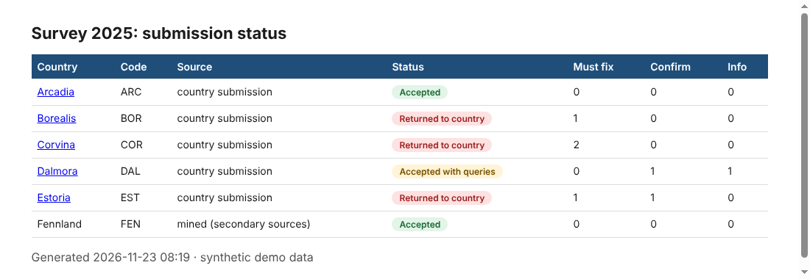
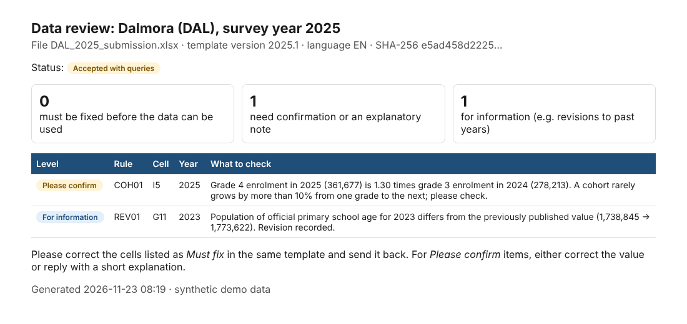

# Excel template automation demo

Automating a multi-year Excel survey template cycle in Python: roll the template forward, prefill it, produce language versions, validate country submissions, return review reports and consolidate everything into a release database.

> **Synthetic data only.** Countries (Arcadia, Borealis, …), figures and templates are invented for this demo. No client code or data is included, and the repository is not affiliated with any organisation.



## Quick start

```bash
python -m venv .venv && source .venv/bin/activate      # Windows: .venv\Scripts\activate
pip install -r requirements.txt
python run_pipeline.py all                              # whole cycle, about 2 seconds
pytest -q                                               # end-to-end and damaged-file tests
streamlit run app.py                                    # optional: check one file in a browser
```

Outputs go to `output/` (open `output/reports/index.html` first).

## What the pipeline does

| Step | Command | Output | Check that it worked |
| --- | --- | --- | --- |
| Generate *(demo setup)* | `generate` | Previous-cycle master template, database extract | — |
| Roll forward | `rollforward` | `master_2025_EN.xlsx` with the new year's column, formulas and validation | Cell-by-cell diff: only expected changes allowed (`checks/rollforward_diff.csv`) |
| Translate | `translate` | FR and ES versions from `labels/labels.csv` | Structural diff against the master: labels may differ, nothing else (`checks/translation_check.csv`) |
| Prefill | `prefill` | One template per country with past years filled from the database | Provenance written to the Metadata sheet |
| Simulate *(demo setup)* | `simulate` | Country submissions with deliberate errors, plus one mined template | — |
| Validate | `validate` | HTML review report per submission, `qc_log.csv` | Rules in `rules/validation_rules.yaml` |
| Consolidate | `consolidate` | `release_2025.sqlite` + CSV exports, revisions report | Returned submissions excluded; country data takes precedence over mined data |

Each step can be run on its own (`python run_pipeline.py validate`). A new cycle is a change to the years in `config.yaml`, not to the code.

## Design choices

- **One layout specification.** `templatekit/spec.py` defines every row, formula and input once. Generation, roll-forward, validation and consolidation all read from it, so they cannot drift apart.
- **Formulas are regenerated, never copied.** The roll-forward rebuilds each formula from its pattern for the new column, then diffs the whole workbook against the previous version. Any change other than the new year stops the run.
- **Python mirrors Excel.** Indicators are recomputed in Python from the inputs. This catches formulas that were overwritten with typed values, without opening Excel. (Checked against LibreOffice recalculation: identical results.)
- **Rules are data, not code.** Each check has an id, a severity and a plain-language message in YAML. Statisticians can add or tune checks without touching Python.
- **Tolerant on input, strict on output.** Submissions are fingerprinted (SHA-256) before they are opened, and every result is logged in `qc_log.csv`. A file that cannot be opened (corrupt, not .xlsx, password-protected), has lost a sheet, or has moved rows or year columns is returned to the country with a structural flag rather than crashing the run. Only accepted data reaches the release.
- **Severity drives the decision.** *Must fix* → returned to the country. *Please confirm* → accepted with queries. *For information* → logged (e.g. revisions to past years).

## Validation rules included

| Id | Type | Severity | Checks |
| --- | --- | --- | --- |
| STR01 | structure | must fix | File opens; sheets, rows, year columns and metadata match the master |
| REQ01 | required | must fix | No blank or text values in survey-year inputs |
| NNG01 | non_negative | must fix | No negative values |
| FRM01 | formula_integrity | must fix | Calculated cells still hold the original formula |
| IND01 | indicator_recalc | must fix | Typed indicators match the recomputed value |
| SUM01 | sum_equals | must fix | Male + female = total enrolment |
| RNG01 | range | please confirm | Gross enrolment ratio within 70–140% |
| YOY01 | yoy_change | please confirm | Enrolment, population, teachers change ≤ ±15% a year |
| COH01 | cohort | please confirm | Grade *g+1* in year *t* ≤ 1.10 × grade *g* in year *t−1* |
| REV01 | revision | information | Past-year values that differ from the previous release |

The five simulated countries each trigger a different case: one clean, one sex-disaggregation mismatch, one overwritten formula, one cohort anomaly with a historical revision, and one missing value with a population jump.



## Repository layout

```
config.yaml                 years, countries, languages, rule files
rules/validation_rules.yaml validation rules (editable)
labels/labels.csv           EN / FR / ES label dictionary
templatekit/
  spec.py                   template layout: rows, formulas, Python recomputation
  workbook.py               build, read, style, data validation, snapshot and diff
  rollforward.py            roll forward, prefill, translate
  validate.py               rule engine
  report.py                 HTML review reports
  consolidate.py            release database (SQLite) and revisions
  synthetic.py              fictional data for the demo
  pipeline.py               the steps, wired together, with the QC log
run_pipeline.py             command line
app.py                      Streamlit checker for a single file
tests/                      end-to-end tests (run in CI)
```

## Adapting it

- **Another template:** change `VARIABLES` in `spec.py`. Add a branch to `compute()` for any new formula.
- **Another database:** `consolidate.py` writes SQLite through pandas. Swap the connection for SQL Server or PostgreSQL (SQLAlchemy) without changing the logic.
- **Another language:** add a column to `labels/labels.csv` and the language code to `config.yaml`.

## Author

Steve KUBENGA BANZA, PMP · Data Management and Analytics · [LinkedIn](https://www.linkedin.com/in/stevekubengabanza/)

Licensed under the MIT License.
